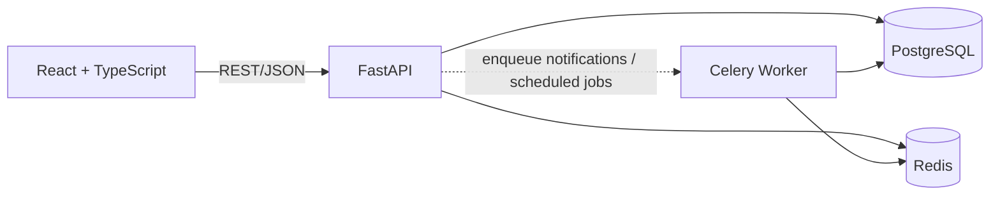
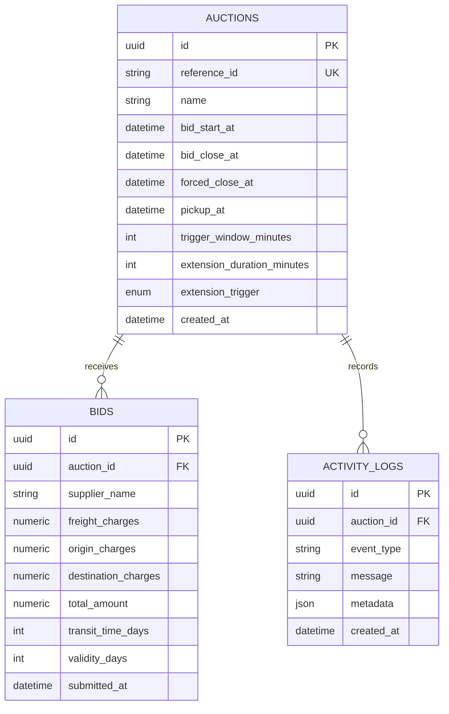

# GoComet British Auction RFQ

Production-oriented reference implementation for the eliminatory-round assignment.

## Stack

- **API:** Python 3.12, FastAPI, SQLAlchemy 2 async, PostgreSQL, Alembic-ready
- **Web:** React 18, TypeScript, Vite, TanStack Query
- **Async-ready:** Redis and Celery services are included in Docker Compose for auction notifications and scheduled closing
- **Quality:** strict TypeScript, Pydantic validation, transactional bid processing, Docker health checks

## Run locally

```powershell
docker compose up --build
```

- Web: http://localhost:5173 (or http://127.0.0.1:5173)
- API docs: http://localhost:8000/docs (or http://127.0.0.1:8000/docs)
- API health: http://localhost:8000/api/v1/health

For frontend-only work:

```powershell
cd frontend
npm install
npm run dev
```

For frontend-only work, keep the API running with Docker Compose in a separate terminal.
The Vite app uses `http://localhost:8000/api/v1` by default. If you open the web app
with `127.0.0.1`, the API also permits that origin.

## Auction rules

An accepted bid must be lower than the current lowest bid. A bid in the configured trigger window can extend the close time according to the selected trigger:

1. **Bid received:** any accepted bid in the window
2. **Any rank change:** accepted bid changes the sorted supplier order
3. **L1 rank change:** the lowest bidder changes

Every extension is clamped to `forced_close_at`; the forced close can never be exceeded. The API performs the bid, rank calculation, extension, and activity-log writes in one database transaction.

## HLD



## Schema



## API

- `GET /api/v1/auctions`
- `POST /api/v1/auctions`
- `GET /api/v1/auctions/{auction_id}`
- `POST /api/v1/auctions/{auction_id}/bids`

OpenAPI is available at `http://localhost:8000/docs`.
